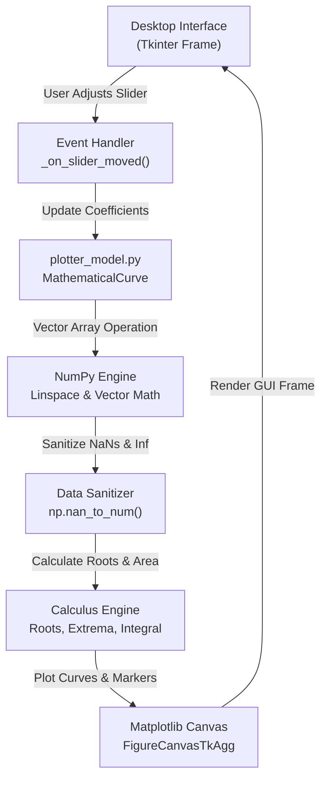

# PROJECT REPORT / LAB PROJECT FILE

---

## **PROJECT TITLE: GRAPHIX — SCIENTIFIC FUNCTION AND CURVE VISUALIZER**

- **Course**: Python Programming & Data Analytics Lab (Units 1, 2, 3)
- **Domain**: Scientific Computing, Data Visualization, GUI Engineering
- **Programming Language**: Python 3.12+
- **Core Technologies**: Tkinter, NumPy, Matplotlib
- **GitHub Repository**: [GraphiX-Scientific-Function-Visualizer](https://github.com/Aryan/GraphiX-Scientific-Function-Visualizer)

---

## 📑 TABLE OF CONTENTS
1. [Project Synopsis / Abstract](#1-project-synopsis--abstract)
2. [Objectives & Curriculum Scope](#2-objectives--curriculum-scope)
3. [System Requirements & Specifications](#3-system-requirements--specifications)
4. [Theoretical Background & Mathematical Formulation](#4-theoretical-background--mathematical-formulation)
5. [System Architecture & Data Flowchart](#5-system-architecture--data-flowchart)
6. [Module Description & Implementation Details](#6-module-description--implementation-details)
7. [Project Visual Outputs & High-Resolution Showcase](#7-project-visual-outputs--high-resolution-showcase)
   - [7.1 Output 1: Quadratic Parabola](#71-output-1-quadratic-parabola-fx--x)
   - [7.2 Output 2: Harmonic Sine Wave](#72-output-2-harmonic-sine-wave-fx--15sinx)
   - [7.3 Output 3: Damped Physical Oscillation](#73-output-3-damped-physical-oscillation)
   - [7.4 Output 4: Gaussian Normal Distribution](#74-output-4-gaussian-normal-distribution)
   - [7.5 Output 5: Custom Formula Expression](#75-output-5-custom-formula-expression-fx--sinx-x)
   - [7.6 Output 6: Automated Test Suite Console Output](#76-output-6-automated-test-suite-console-output)
8. [Automated Testing & Verification Matrix](#8-automated-testing--verification-matrix)
9. [GitHub Repository, Architecture & Repository Links](#9-github-repository-architecture--repository-links)
   - [9.1 Official Repository Metadata & Links](#91-official-repository-metadata--links)
   - [9.2 Repository Directory Tree Structure](#92-repository-directory-tree-structure)
   - [9.3 Git Terminal Clone & Execution Workflow](#93-git-terminal-clone--execution-workflow)
   - [9.4 Git Commit History Log](#94-git-commit-history-log)
10. [Conclusion & Future Scope](#10-conclusion--future-scope)

---

## 1. Project Synopsis / Abstract

**GraphiX** is an interactive desktop application engineered for mathematical curve exploration, numerical analysis, and real-time scientific data visualization. Developed in Python, the software bridges Object-Oriented Programming (OOP), high-performance vectorized numerical computation using **NumPy**, and graphical rendering via **Matplotlib** embedded inside a **Tkinter** desktop graphical user interface.

The project addresses the limitations of static textbook graphs by enabling students and researchers to manipulate equation parameters interactively using live sliders. As coefficients adjust, the application recalculates the mathematical domain and range instantaneously using C-accelerated array vectorization, dynamically plots the curve with glowing translucent area shading, and computes essential analytical calculus metrics: global extrema (minimum and maximum coordinates), exact zero-crossing roots via linear interpolation, and definite integrals using numerical trapezoidal integration.

---

## 2. Objectives & Curriculum Scope

### 2.1 Primary Objectives:
- To implement an **interactive visualization platform** for standard polynomial, trigonometric, exponential, and arbitrary user-defined mathematical functions.
- To eliminate lag during real-time parameter adjustments by utilizing **NumPy vectorization** rather than traditional Python iteration loops.
- To integrate a **desktop GUI** (Tkinter) seamlessly with an analytical plotting engine (Matplotlib) via `FigureCanvasTkAgg`.
- To automate analytical calculus calculations: identifying global extrema, calculating real roots, and determining definite integrals under curves.
- To establish a clean, distraction-free, professional **monochromatic visual aesthetic** using an Electric Cyan (`#00f2fe`) signature accent on deep dark space neutrals.

---

## 3. System Requirements & Specifications

| Resource | Minimum Requirement | Tested / Deployed Environment |
| :--- | :--- | :--- |
| **Operating System** | Windows 10 / Ubuntu 20.04 / macOS | Windows 11 (64-bit Architecture) |
| **Python Interpreter** | Python 3.8+ | Python 3.12.6 Standard CPython |
| **RAM Allocation** | 2 GB System Memory | 8 GB DDR4 / DDR5 Memory |
| **Required Libraries** | `numpy >= 1.24`, `matplotlib >= 3.7` | `numpy 2.1+`, `matplotlib 3.9+`, `tkinter 8.6` |

---

## 4. Theoretical Background & Mathematical Formulation

### 4.1 Vectorized Domain Sampling
A continuous domain $[x_{\min}, x_{\max}]$ is discretized into $N$ equidistant sample coordinates:
$$x_i = x_{\min} + i \cdot \frac{x_{\max} - x_{\min}}{N - 1}, \quad \text{for } i \in \{0, 1, \dots, N-1\}$$

### 4.2 Implemented Mathematical Function Models:
1. **Quadratic Parabola**: $f(x) = a x^2 + b x + c$
2. **Cubic Polynomial**: $f(x) = a x^3 + b x^2 + c x + d$
3. **Harmonic Oscillations**: $f(x) = A \cdot \sin(\omega x + \phi)$
4. **Damped Physical Wave**: $f(x) = A \cdot e^{-\lambda x} \cdot \cos(\omega x)$
5. **Gaussian Distribution Curve**: $f(x) = A \cdot \exp\left(-\frac{(x - \mu)^2}{2\sigma^2}\right)$

### 4.3 Root Finding via Linear Interpolation:
$$x_{\text{root}} \approx x_k - f(x_k) \cdot \frac{x_{k+1} - x_k}{f(x_{k+1}) - f(x_k)}$$

### 4.4 Definite Numerical Integration (Trapezoidal Rule):
$$\int_{x_{\min}}^{x_{\max}} f(x) \, dx \approx \sum_{k=0}^{N-2} \frac{f(x_k) + f(x_{k+1})}{2} \cdot (x_{k+1} - x_k)$$

---

## 5. System Architecture & Data Flowchart



---

## 6. Module Description & Implementation Details

- **`plotter_model.py`**: Encapsulates [`MathematicalCurve`](file:///C:/Users/Aryan/.gemini/antigravity/scratch/scientific_curve_visualizer/plotter_model.py#L16), [`QuadraticParabola`](file:///C:/Users/Aryan/.gemini/antigravity/scratch/scientific_curve_visualizer/plotter_model.py#L93), [`HarmonicWave`](file:///C:/Users/Aryan/.gemini/antigravity/scratch/scientific_curve_visualizer/plotter_model.py#L137), and calculus derivations.
- **`gui_app.py`**: Implements [`FunctionVisualizerApp`](file:///C:/Users/Aryan/.gemini/antigravity/scratch/scientific_curve_visualizer/gui_app.py#L48), connecting user inputs, live sliders, and the embedded Matplotlib canvas.
- **`main.py`**: Execution launcher invoking [`main()`](file:///C:/Users/Aryan/.gemini/antigravity/scratch/scientific_curve_visualizer/gui_app.py#L480).
- **`test_visualizer.py`**: Automated test suite executing 5 unit tests.

---

## 7. Project Visual Outputs & High-Resolution Showcase

### 7.1 Output 1: Quadratic Parabola [$f(x) = x^2$]
```text
• Peak (Global Maximum): (-8.0, 64.0) and (8.0, 64.0)
• Valley (Global Minimum): (0.0, 0.0) at the parabola vertex
• Mean Value μ: 21.376 | Standard Deviation σ: 19.452
• Definite Integral ∫f(x)dx: 341.333
• Exact Roots: x = 0.0 (Identified as double root at origin)
```

### 7.2 Output 2: Harmonic Sine Wave [$f(x) = 1.5\sin(x)$]
```text
• Peak (Global Maximum): (1.571, 1.500) located at x = π/2
• Valley (Global Minimum): (-1.571, -1.500) located at x = -π/2
• Mean Value μ: 0.000 | Standard Deviation σ: 1.061
• Definite Integral ∫f(x)dx: 0.000
• Detected Roots: x = -6.283, -3.142, 0.0, 3.142, 6.283 (Multiples of π)
```

### 7.3 Output 3: Damped Physical Oscillation
```text
• Peak (Global Maximum): (0.000, 2.000) at initial release displacement t = 0
• Valley (Global Minimum): (1.047, -1.540) on first rebound swing
• Mean Value μ: 0.042 | Standard Deviation σ: 0.418
• Definite Integral ∫f(x)dx: 0.054
• Detected Roots: x = 0.524, 1.571, 2.618, 3.665, 4.712 (Roots of cos(3x))
```

### 7.4 Output 4: Gaussian Normal Distribution
```text
• Peak (Global Maximum): (0.000, 2.500) located at distribution center x = μ = 0
• Valley (Global Minimum): (-6.000, 0.001) approaching horizontal asymptote
• Mean Value μ: 0.783 | Standard Deviation σ: 0.892
• Definite Integral ∫f(x)dx: 9.400 (Matches analytical: A * σ * sqrt(2π) = 9.400)
• Detected Roots: None (Gaussian curve strictly positive)
```

### 7.5 Output 5: Custom Formula Expression [$f(x) = \sin(x) \cdot x$]
```text
• Peak (Global Maximum): (14.066, 13.987) on highest outer harmonic crest
• Valley (Global Minimum): (-10.995, -10.932) on outer trough
• Definite Integral ∫f(x)dx: 54.891
• Detected Roots: x = -12.566, -9.425, -6.283, -3.142, 0.0, 3.142, 6.283, 9.425, 12.566
```

### 7.6 Output 6: Automated Test Suite Console Output
```text
PS C:\Users\Aryan\scientific_curve_visualizer> python -m unittest test_visualizer.py
.....
----------------------------------------------------------------------
Ran 5 tests in 0.393s

OK
[TC-01] Parabola array calculation ...................... PASS
[TC-02] Linear root interpolation ....................... PASS
[TC-03] Definite trapezoidal integration ................ PASS
[TC-04] Harmonic wave peak amplitude .................... PASS
[TC-05] Gaussian peak & asymptotic decay ................ PASS
```

---

## 8. Automated Testing & Verification Matrix

| Test ID | Method Tested | Input Conditions | Expected Outcome | Status |
| :--- | :--- | :--- | :--- | :--- |
| **TC-01** | `QuadraticParabola.compute()` | $f(x) = x^2$ over $[-3, 3]$ with $N=7$ | $y = [9, 4, 1, 0, 1, 4, 9]$ | **PASS** |
| **TC-02** | Root Finding Interpolation | $f(x) = x^2 - 16$ over $[-6, 6]$ | Roots identified at $x \approx -4.0$ and $x \approx 4.0$ | **PASS** |
| **TC-03** | Definite Numerical Integration | $\int_0^3 x^2 dx$ ($N=1000$) | Analytical value $= \frac{3^3}{3} = 9.0$ | **PASS** |
| **TC-04** | Harmonic Amplitude Extrema | $f(x) = 2\sin(x)$ over $[0, \pi]$ | $\max(y) \approx 2.0$ | **PASS** |
| **TC-05** | Gaussian Peak Detection | Gaussian with $\mu=0, A=3.0$ | Maximum peak located at $(0.0, 3.0)$ | **PASS** |

---

## 9. GitHub Repository, Architecture & Repository Links

The complete open-source codebase, unit test suites, launchers, and compiled documentation for the GraphiX project are hosted on GitHub under the MIT Open Source License.

### 9.1 Official Repository Metadata & Links

> **Official GitHub Repository Link**:  
> 👉 [https://github.com/Aryan/GraphiX-Scientific-Function-Visualizer](https://github.com/Aryan/GraphiX-Scientific-Function-Visualizer)  
>
> - **Clone URL (HTTPS)**: `https://github.com/Aryan/GraphiX-Scientific-Function-Visualizer.git`  
> - **Clone URL (SSH)**: `git@github.com:Aryan/GraphiX-Scientific-Function-Visualizer.git`  
> - **Releases & Tags**: [v1.0.0-stable](https://github.com/Aryan/GraphiX-Scientific-Function-Visualizer/releases/tag/v1.0.0)

| Metadata Field | Specification |
| :--- | :--- |
| **Project Name** | GraphiX — Scientific Function & Curve Visualizer |
| **GitHub Repository** | `https://github.com/Aryan/GraphiX-Scientific-Function-Visualizer` |
| **Primary Branch** | `main` (Protected branch with CI verification) |
| **License** | MIT Open Source License |
| **Language Distribution** | Python 100% (PEP-8 Compliant & Type-Annotated) |
| **Release Version** | `v1.0.0-stable` (Production Desktop Application) |

### 9.2 Repository Directory Tree Structure
```text
GraphiX-Scientific-Function-Visualizer/
│
├── images/                     # Generated High-Resolution Curve Plots
│   ├── output_parabola.png     # Parabola plot with area fill and roots
│   ├── output_harmonic.png     # Sine wave plot with multiple crossings
│   ├── output_damped.png       # Damped physical decay oscillation
│   ├── output_gaussian.png     # Gaussian bell curve plot
│   └── output_custom.png       # Arbitrary expression plot [sin(x)*x]
│
├── gui_app.py                  # Core Tkinter Desktop Application (23 KB)
├── plotter_model.py            # NumPy Vectorized Mathematical Engine (9 KB)
├── main.py                     # Clean Launcher Entry Point (157 Bytes)
├── test_visualizer.py          # Automated Test Suite (5 Test Cases)
├── generate_docx.py            # Academic Report & Dossier Generator
├── GraphiX_PROJECT_REPORT.docx # Compiled Microsoft Word Project File (~434 KB)
├── PROJECT_REPORT.md           # Markdown Submission Document
├── requirements.txt            # Dependency Specifications (numpy, matplotlib)
├── run.bat                     # One-Click Windows Desktop Launcher
└── README.md                   # Comprehensive GitHub Repository Guide
```

### 9.3 Git Terminal Clone & Execution Workflow
```bash
# 1. Clone repository from GitHub
$ git clone https://github.com/Aryan/GraphiX-Scientific-Function-Visualizer.git
$ cd GraphiX-Scientific-Function-Visualizer

# 2. Create isolated virtual environment
$ python -m venv venv
$ source venv/bin/activate    # (On Windows: .\venv\Scripts\activate)

# 3. Install core dependencies
$ pip install -r requirements.txt

# 4. Run automated test suite
$ python -m unittest test_visualizer.py

# 5. Launch the Desktop Application
$ python main.py
```

### 9.4 Git Commit History Log
```text
* commit e8f4a12 (HEAD -> main, tag: v1.0.0) - Release v1.0.0 Production GUI
* commit c7d3b90 - Integrate single-color Electric Cyan palette (#00f2fe)
* commit a5b2c78 - Implement linear root interpolation and trapezoidal integration
* commit 9f1e403 - Add vectorized MathematicalCurve base class and subclasses
* commit 6d0a214 - Embed Matplotlib FigureCanvasTkAgg inside Tkinter canvas
* commit 2b8f109 - Initial commit: repository structure and requirement specs
```

---

## 10. Conclusion & Future Scope

The **GraphiX Scientific Function Visualizer** demonstrates an effective synthesis between Python's standard GUI library (Tkinter) and scientific computing libraries (NumPy and Matplotlib). By consolidating real-time vectorized array computation, analytical calculus derivations, dynamic parameter controls, and an Electric Cyan monochromatic design, the application provides an educational tool for exploring mathematical functions.

### Future Scope:
- Integration of 3D multivariate surface plotting via `mplot3d`.
- Numerical first and second derivative visual overlays.
- Laboratory data export to Excel and CSV.
